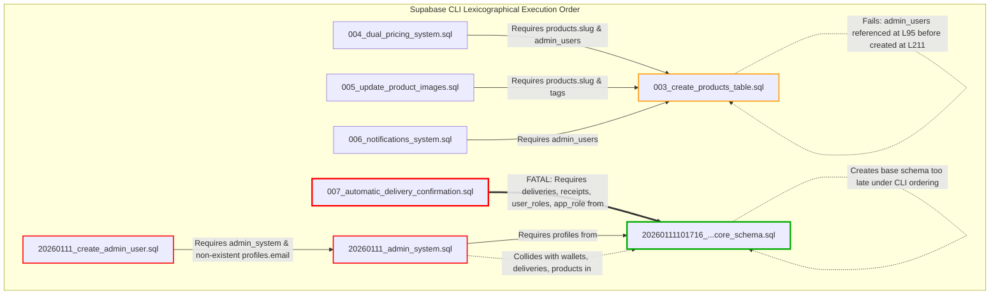

# STEP 4: Database Migration Audit

**Project:** Delight Milk (v2.0.0)  
**Database Target:** Local Supabase / PostgreSQL  
**Audit Scope:** `supabase/migrations/` (8 migration files)  
**Inspection Mode:** Read-Only Static SQL & Schema Analysis  
**Audit Status:** Complete  

---

## 1. Executive Summary

A comprehensive audit of the `supabase/migrations/` directory was conducted to evaluate readiness for a clean local PostgreSQL / Supabase deployment.

### ⚠️ Critical Finding: Migrations Cannot Run As-Is
The existing migration set **CANNOT successfully run on a fresh Supabase database**. Attempting to execute them will cause fatal PostgreSQL errors regardless of execution method:
1. **Under Supabase CLI (`supabase start` / `supabase db reset`)**: Migrations run lexicographically by file name. Files starting with `003_` run before `20260111101716_...`, crashing immediately on missing prerequisite types, tables, and forward references.
2. **Under Manual Guided Order (`SUPABASE_DATABASE_SETUP_GUIDE.md`)**: Even if `20260111101716_...` is executed first, subsequent migrations (`003_create_products_table.sql`, `20260111_admin_system.sql`, `20260111_create_admin_user.sql`) crash due to `CREATE TABLE IF NOT EXISTS` skipping missing column definitions, forward-referencing undeclared tables in RLS policies, missing PostgreSQL extensions (`uuid-ossp`), and querying nonexistent columns (`profiles.email`).
3. **Architectural Triplication**: Three conflicting architectural patterns coexist in the directory, attempting to define colliding versions of `products`, `subscriptions`, `wallets` vs `wallet`, `deliveries` vs `daily_deliveries`, and three incompatible admin authorization models (`user_roles` table vs `admin_users` table vs `profiles.role` column).

---

## 2. Chronological & Logical Migration File Analysis

The 8 files in `supabase/migrations/` analyzed in their designed / chronological logical sequence:

```
1. 20260111101716_ecc6ed7f-d37a-449d-a1dc-f88b7b8413f4.sql  (Core Foundational Schema)
2. 003_create_products_table.sql                             (Catalog Expansion)
3. 004_dual_pricing_system.sql                               (Pricing & History)
4. 005_update_product_images.sql                             (Image & Slug Patch)
5. 006_notifications_system.sql                              (Notifications System)
6. 007_automatic_delivery_confirmation.sql                   (Delivery Tracking & Audit)
7. 20260111_admin_system.sql                                 (Alternative Admin Schema)
8. 20260111_create_admin_user.sql                            (Admin Seed Script)
```

---

### Migration 1: `20260111101716_ecc6ed7f-d37a-449d-a1dc-f88b7b8413f4.sql`

1. **File Name:** `20260111101716_ecc6ed7f-d37a-449d-a1dc-f88b7b8413f4.sql`
2. **Tables Created:**
   - `public.user_roles`: Role assignments linking `auth.users(id)` with `app_role`.
   - `public.profiles`: Customer profile metadata (`user_id REFERENCES auth.users(id)`, `full_name`, `phone`, `address`, `avatar_url`).
   - `public.products`: Core product catalog (`id`, `name`, `description`, `category`, `unit`, `price_per_unit`, `image_url`, `is_active`).
   - `public.subscriptions`: Recurring daily orders linking user and product.
   - `public.deliveries`: Calendar delivery instances linked to `subscriptions` and `products`.
   - `public.wallets`: Customer credit balance table (`user_id REFERENCES auth.users(id)`).
   - `public.wallet_transactions`: Ledger entries (`wallet_id REFERENCES public.wallets(id)`).
   - `public.receipts`: Monthly aggregated billing invoices.
   - `public.receipt_items`: Line items for billing receipts.
3. **Tables Altered:**
   - Enables RLS on all 9 created tables.
4. **Types/Enums Created:**
   - `public.app_role AS ENUM ('admin', 'delivery_partner', 'customer')`
   - `public.delivery_status AS ENUM ('delivered', 'missed', 'paused', 'upcoming')`
   - `public.receipt_status AS ENUM ('paid', 'due', 'processing')`
5. **Functions Created:**
   - `public.has_role(_user_id UUID, _role app_role) RETURNS BOOLEAN`: Security Definer role check against `user_roles`.
   - `public.update_updated_at_column() RETURNS TRIGGER`: Automatically sets `NEW.updated_at = now()`.
   - `public.handle_new_user() RETURNS TRIGGER`: Auto-provisions profile, wallet ($0), and customer role on signup.
6. **Triggers Created:**
   - `update_profiles_updated_at` ON `public.profiles`
   - `update_products_updated_at` ON `public.products`
   - `update_subscriptions_updated_at` ON `public.subscriptions`
   - `update_deliveries_updated_at` ON `public.deliveries`
   - `update_wallets_updated_at` ON `public.wallets`
   - `update_receipts_updated_at` ON `public.receipts`
   - `on_auth_user_created` AFTER INSERT ON `auth.users` FOR EACH ROW EXECUTE FUNCTION `public.handle_new_user()`
7. **RLS Policies Created:**
   - 17 granular policies covering all 9 tables for users, delivery partners, and admins via `public.has_role()`.
8. **Seed/Default Data Inserted:**
   - 8 foundational dairy products (Cow Milk, Buffalo Milk, Toned Milk, Organic Milk, Fresh Curd, Paneer, Butter, Ghee) with Unsplash photo URLs.
9. **Dependencies on Previous Migrations:**
   - None. Built purely on PostgreSQL primitives and Supabase `auth.users`.
10. **Duplicate/Overlapping Definitions:**
    - Establishes the base schema that `003_...` and `20260111_admin_system.sql` later duplicate. Matches TypeScript types in `src/integrations/supabase/types.ts`.

---

### Migration 2: `003_create_products_table.sql`

1. **File Name:** `003_create_products_table.sql`
2. **Tables Created:**
   - `public.products` (via `CREATE TABLE IF NOT EXISTS public.products`): Defines an expanded schema including `slug`, `rating`, `review_count`, `stock_status`, `stock_quantity`, `low_stock_threshold`, `is_featured`, `tags`, `images`, and `nutritional_info`.
   - `public.admin_users` (via `CREATE TABLE IF NOT EXISTS public.admin_users` at line 211): Table intended for admin authorization (`user_id UUID REFERENCES auth.users(id)`).
3. **Tables Altered:**
   - Enables RLS on `products` and `admin_users`.
4. **Types/Enums Created:**
   - None (uses `VARCHAR` and inline `CHECK` constraints).
5. **Functions Created:**
   - `public.update_updated_at_column() RETURNS TRIGGER` (redefines function).
   - `public.get_products_by_category(category_name VARCHAR) RETURNS SETOF public.products`.
   - `public.search_products(search_term VARCHAR) RETURNS SETOF public.products`.
6. **Triggers Created:**
   - `update_products_updated_at` BEFORE UPDATE ON `public.products`.
7. **RLS Policies Created:**
   - `products`: "Anyone can view active products", "Authenticated users can view all products", "Only admins can insert products", "Only admins can update products", "Only admins can delete products".
   - `admin_users`: "Only admins can view admin users".
8. **Seed/Default Data Inserted:**
   - Inserts 8 products with rich attributes (`slug`, `rating`, `tags`) using local `/images/*.jpg` paths, ending with `ON CONFLICT (slug) DO NOTHING`.
9. **Dependencies on Previous Migrations:**
   - **CRITICAL BUG (Internal Forward Reference):** Lines 95–131 define RLS policies that execute `SELECT user_id FROM public.admin_users`, but `public.admin_users` is not created until line 211. If `admin_users` does not already exist, PostgreSQL throws: `ERROR: relation "public.admin_users" does not exist`.
   - **CRITICAL BUG (Schema Incompatibility):** If run after `20260111101716`, `CREATE TABLE IF NOT EXISTS public.products` is skipped. The table retains the base schema without `slug`, `tags`, `is_featured`, `rating`, etc. Lines 57, 59, 61, 138, and 163 immediately fail with `ERROR: column "slug" does not exist`.
10. **Duplicate/Overlapping Definitions:**
    - Duplicates `public.products` and `update_updated_at_column()`. Introduces `admin_users` table which conflicts with `user_roles`.

---

### Migration 3: `004_dual_pricing_system.sql`

1. **File Name:** `004_dual_pricing_system.sql`
2. **Tables Created:**
   - `public.product_prices`: Historical and future pricing schedules (`regular_price`, `subscription_price`, `effective_from`, `effective_until`).
   - `public.price_history`: Audit trail for price modifications (`old_regular_price`, `new_regular_price`, etc.).
3. **Tables Altered:**
   - `public.products`: Adds columns `subscription_enabled BOOLEAN DEFAULT true`, `addon_product BOOLEAN DEFAULT false`, `cutoff_time TIME DEFAULT '22:00:00'` via `DO $$` block.
   - Enables RLS on `product_prices` and `price_history`.
4. **Types/Enums Created:**
   - None.
5. **Functions Created:**
   - `public.get_price_for_date(p_product_id, p_date, p_has_subscription) RETURNS DECIMAL(10,2)`.
   - `public.get_current_price(p_product_id, p_has_subscription) RETURNS DECIMAL(10,2)`.
   - `public.validate_price_change() RETURNS TRIGGER`: Enforces future-only price adjustments.
   - `public.log_price_change() RETURNS TRIGGER`: Populates `price_history` on update.
6. **Triggers Created:**
   - `validate_price_change_trigger` BEFORE INSERT OR UPDATE ON `public.product_prices`.
   - `log_price_change_trigger` AFTER INSERT OR UPDATE ON `public.product_prices`.
7. **RLS Policies Created:**
   - Policies on `product_prices` and `price_history` restricting write access to `admin_users`.
8. **Seed/Default Data Inserted:**
   - Seeds pricing for Buffalo Milk, Cow Milk, Curd, Ghee by querying `public.products WHERE slug = ...`.
   - Upserts 3 products (`Fresh Paneer`, `Pure Butter`, `Cheddar Cheese`) into `public.products ON CONFLICT (slug)`.
   - Seeds corresponding initial prices.
9. **Dependencies on Previous Migrations:**
   - Requires `public.products` to exist.
   - Requires `public.products.slug` column (from `003`).
   - Requires `public.admin_users` to exist for RLS policies.
10. **Duplicate/Overlapping Definitions:**
    - Re-inserts Paneer and Butter, which were already inserted in `20260111101716` and `003`.

---

### Migration 4: `005_update_product_images.sql`

1. **File Name:** `005_update_product_images.sql`
2. **Tables Created:** None.
3. **Tables Altered:** None (data update only).
4. **Types/Enums Created:** None.
5. **Functions Created:** None.
6. **Triggers Created:** None.
7. **RLS Policies Created:** None.
8. **Seed/Default Data Inserted:**
   - Updates `image_url` on `public.products` for 7 product slugs to local `/images/*.jpg` paths.
   - Attempts to rename product with `slug = 'toned-milk'` to `Organic Milk` (`slug = 'organic-milk'`).
9. **Dependencies on Previous Migrations:**
   - Requires `public.products` with columns `slug`, `image_url`, and `tags`.
   - If run after `003`, `slug = 'toned-milk'` does not exist because `003` already seeded it directly as `organic-milk` with local images.
10. **Duplicate/Overlapping Definitions:**
    - Redundant with seed data in `003_create_products_table.sql`.

---

### Migration 5: `006_notifications_system.sql`

1. **File Name:** `006_notifications_system.sql`
2. **Tables Created:**
   - `public.notifications`: User notifications table with columns `id`, `user_id REFERENCES auth.users(id)`, `type`, `title`, `message`, `is_read`, `is_deleted`, `action_url`, `metadata`.
3. **Tables Altered:**
   - Enables RLS on `public.notifications`.
4. **Types/Enums Created:**
   - None (uses `VARCHAR(50)` with `CHECK (type IN (...))`).
5. **Functions Created:**
   - `public.get_unread_notification_count(p_user_id UUID) RETURNS INTEGER`.
   - `public.mark_notification_read(p_notification_id UUID, p_user_id UUID) RETURNS BOOLEAN`.
   - `public.mark_all_notifications_read(p_user_id UUID) RETURNS INTEGER`.
   - `public.delete_notification(p_notification_id UUID, p_user_id UUID) RETURNS BOOLEAN`.
   - `public.clear_all_notifications(p_user_id UUID) RETURNS INTEGER`.
   - `public.create_notification(...) RETURNS UUID`.
6. **Triggers Created:** None.
7. **RLS Policies Created:**
   - "Users can view own notifications"
   - "Users can update own notifications"
   - "Users can delete own notifications"
   - "System can insert notifications" (Restricted via `SELECT user_id FROM public.admin_users`).
8. **Seed/Default Data Inserted:** None.
9. **Dependencies on Previous Migrations:**
   - Requires `auth.users`.
   - Requires `public.admin_users` table for insert policy.
10. **Duplicate/Overlapping Definitions:** None for table itself.

---

### Migration 6: `007_automatic_delivery_confirmation.sql`

1. **File Name:** `007_automatic_delivery_confirmation.sql`
2. **Tables Created:**
   - `public.delivery_audit_log`: Audit trail for delivery confirmations and admin status corrections (`delivery_id REFERENCES public.deliveries(id)`, `old_status delivery_status`, `new_status delivery_status`).
3. **Tables Altered:**
   - `public.deliveries`: Adds tracking columns `marked_delivered_at`, `marked_delivered_by`, `delivery_partner_name`, `is_locked`, `locked_at`, `locked_reason`, `offline_marked`, `synced_at`.
   - Enables RLS on `public.delivery_audit_log`.
4. **Types/Enums Created:** None (uses `app_role` and `delivery_status` enums).
5. **Functions Created:**
   - `public.is_month_locked_for_billing(_user_id UUID, _delivery_date DATE) RETURNS BOOLEAN`.
   - `public.mark_delivery_delivered(_delivery_id UUID, _marked_by UUID, ...) RETURNS JSONB`.
   - `public.admin_correct_delivery(_delivery_id UUID, _admin_id UUID, ...) RETURNS JSONB`.
   - `public.lock_month_for_billing(_user_id UUID, _billing_month DATE) RETURNS JSONB`.
   - `public.notify_delivery_status_change() RETURNS TRIGGER`.
6. **Triggers Created:**
   - `trigger_notify_delivery_status_change` AFTER UPDATE ON `public.deliveries` (sends Postgres `pg_notify` payload).
7. **RLS Policies Created:**
   - "Users can view their own delivery audit logs" (SELECT)
   - "Admins can view all audit logs" (SELECT via `public.has_role(auth.uid(), 'admin')`)
   - "Only system can insert audit logs" (INSERT WITH CHECK false)
8. **Seed/Default Data Inserted:** None.
9. **Dependencies on Previous Migrations:**
   - **HARD DEPENDENCY on `20260111101716_...`**: Strictly requires `public.deliveries`, `public.receipts`, `public.user_roles`, `public.has_role()`, enum `delivery_status`, and enum `app_role`.
   - Under Supabase CLI lexicographical ordering, this file runs BEFORE `20260111101716_...` and fails immediately.
10. **Duplicate/Overlapping Definitions:** None. Perfectly extends the base schema.

---

### Migration 7: `20260111_admin_system.sql`

1. **File Name:** `20260111_admin_system.sql`
2. **Tables Created:**
   - `public.products` (via `CREATE TABLE IF NOT EXISTS products` with columns `product_name`, `category`, `price_per_unit`, `is_available`, `created_by REFERENCES profiles(id)`).
   - `public.subscriptions` (via `CREATE TABLE IF NOT EXISTS subscriptions` with columns `user_id REFERENCES profiles(id)`, `daily_quantity`, `paused_by_admin`, etc.).
   - `public.daily_deliveries` (via `CREATE TABLE IF NOT EXISTS daily_deliveries` with columns `user_id REFERENCES profiles(id)`, `delivery_boy_id`, `area`).
   - `public.admin_logs` (via `CREATE TABLE IF NOT EXISTS admin_logs` with columns `admin_id REFERENCES profiles(id)`, `action`, `details`).
   - `public.wallet` (singular! via `CREATE TABLE IF NOT EXISTS wallet` with columns `user_id REFERENCES profiles(id) UNIQUE`, `balance`).
   - `public.wallet_transactions` (via `CREATE TABLE IF NOT EXISTS wallet_transactions` with columns `user_id REFERENCES profiles(id)`, `amount`, `source`, `status`).
3. **Tables Altered:**
   - `public.profiles`: Adds columns `role TEXT DEFAULT 'customer'`, `is_blocked BOOLEAN DEFAULT false`, `blocked_at TIMESTAMP`, `blocked_by UUID REFERENCES profiles(id)`.
   - Enables RLS on `products`, `subscriptions`, `daily_deliveries`, `admin_logs`, `wallet`, `wallet_transactions`.
4. **Types/Enums Created:** None (uses plain `TEXT` columns).
5. **Functions Created:**
   - `public.is_admin(user_id UUID) RETURNS BOOLEAN`: Checks `profiles.role = 'admin'`.
   - `public.log_admin_action(...) RETURNS UUID`.
   - `public.update_updated_at_column() RETURNS TRIGGER`.
6. **Triggers Created:**
   - `update_products_updated_at` ON `products`.
   - `update_subscriptions_updated_at` ON `subscriptions`.
   - `update_wallet_updated_at` ON `wallet`.
7. **RLS Policies Created:**
   - Multiple RLS policies across the 6 tables using `is_admin(auth.uid())`.
8. **Seed/Default Data Inserted:** None.
9. **Dependencies on Previous Migrations:**
   - Requires `profiles` table to exist for line 8 (`ALTER TABLE profiles ADD COLUMN ...`).
   - **CRITICAL BUG (Missing Extension):** Uses `DEFAULT uuid_generate_v4()`, but does not execute `CREATE EXTENSION IF NOT EXISTS "uuid-ossp"`.
   - **CRITICAL BUG (ID Model Mismatch):** Foreign keys reference `profiles(id)` and RLS policies equate `auth.uid() = user_id`. However, in `20260111101716`, `profiles.id` is a random UUID while `profiles.user_id` is `auth.uid()`. This breaks referential integrity and makes RLS policies evaluate to `false`.
10. **Duplicate/Overlapping Definitions:**
    - Catastrophic collision with `20260111101716`: Creates duplicate tables (`wallet` vs `wallets`, `daily_deliveries` vs `deliveries`), mismatched column names (`product_name` vs `name`, `is_available` vs `is_active`, `daily_quantity` vs `quantity`), and a third conflicting admin model (`is_admin()` vs `has_role()`).

---

### Migration 8: `20260111_create_admin_user.sql`

1. **File Name:** `20260111_create_admin_user.sql`
2. **Tables Created:** None.
3. **Tables Altered:** None.
4. **Types/Enums Created:** None.
5. **Functions Created:** None.
6. **Triggers Created:** None.
7. **RLS Policies Created:** None.
8. **Seed/Default Data Inserted:**
   - Executes DML queries attempting to set `role = 'admin'` for `'admin@dailydrop.com'` and `'manager@dailydrop.com'`.
9. **Dependencies on Previous Migrations:**
   - Requires `20260111_admin_system.sql`.
   - **CRITICAL BUG (Nonexistent Column):** Queries and updates `profiles.email` (lines 15, 24, 29, 51, 76, 89, 98). The `profiles` table does NOT contain an `email` column in any migration file. Throws `ERROR: column "email" does not exist`.
   - **NOT A MIGRATION:** This is a manual maintenance script containing ad-hoc statements (`SELECT`, `UPDATE` on non-seeded users). It should not reside in `supabase/migrations/`.
10. **Duplicate/Overlapping Definitions:** Operates on the deprecated `profiles.role` architecture.

---

## 3. Complete Table & Entity Map

The following map catalogs all database entities across all 8 migration files and reveals architectural collisions:

| Table / Entity | Defined In | Primary Key | Foreign Key References | Schema / Column Conflicts |
| :--- | :--- | :--- | :--- | :--- |
| **`user_roles`** | `20260111101716` | `id UUID` | `user_id -> auth.users(id)` | Canonical role management. In conflict with `admin_users` and `profiles.role`. |
| **`admin_users`** | `003` (line 211) | `user_id UUID` | `user_id -> auth.users(id)` | Defined *after* referenced in RLS. Redundant with `user_roles`. |
| **`profiles`** | `20260111101716`, `20260111_admin` | `id UUID` | `user_id -> auth.users(id)` | `20260111101716` has `user_id`. `20260111_admin` adds `role`, `is_blocked`, `blocked_by`. Neither adds `email`. |
| **`products`** | `20260111101716`, `003`, `004`, `20260111_admin` | `id UUID` | None / `created_by -> profiles` | **Severe Conflict:**<br>• `20260111101716`: basic columns (`name`, `is_active`)<br>• `003`: rich catalog (`slug`, `rating`, `tags`, etc.)<br>• `004`: adds `subscription_enabled`, `cutoff_time`<br>• `20260111_admin`: uses `product_name`, `is_available` |
| **`product_prices`** | `004` | `id UUID` | `product_id -> products(id)` | Clean table, but RLS references `admin_users`. |
| **`price_history`** | `004` | `id UUID` | `product_id -> products(id)` | Clean audit table, but RLS references `admin_users`. |
| **`subscriptions`** | `20260111101716`, `20260111_admin` | `id UUID` | `user_id -> auth.users` vs `profiles` | **Conflict:** `quantity` (`20260111101716`) vs `daily_quantity` (`20260111_admin`). FK to `auth.users` vs `profiles`. |
| **`deliveries`** | `20260111101716`, `007` | `id UUID` | `subscription_id`, `product_id` | Canonical customer calendar table. Extended cleanly by `007`. |
| **`daily_deliveries`** | `20260111_admin` | `id UUID` | `user_id -> profiles`, `products` | **Conflict:** Duplicate/competing table to `deliveries`. Used only in `useAdmin.ts`. |
| **`delivery_audit_log`** | `007` | `id UUID` | `delivery_id -> deliveries(id)` | Clean audit table linked to `deliveries` and `has_role()`. |
| **`wallets` (plural)** | `20260111101716` | `id UUID` | `user_id -> auth.users(id)` | Canonical customer wallet table. Expected by `useWallet.ts`, `usePhonePePayment.ts`. |
| **`wallet` (singular)** | `20260111_admin` | `id UUID` | `user_id -> profiles(id)` | **Conflict:** Duplicate table. Used only in `useAdmin.ts` line 716. |
| **`wallet_transactions`** | `20260111101716`, `20260111_admin` | `id UUID` | `wallet_id -> wallets` vs `profiles` | **Conflict:** `20260111101716` links to `wallets(id)`. `20260111_admin` re-creates it linking only to `profiles(id)`. |
| **`receipts`** | `20260111101716` | `id UUID` | `user_id -> auth.users(id)` | Canonical monthly billing invoices table. |
| **`receipt_items`** | `20260111101716` | `id UUID` | `receipt_id -> receipts(id)` | Canonical line items table. |
| **`notifications`** | `006` | `id UUID` | `user_id -> auth.users(id)` | Clean notifications table, but insert policy references `admin_users`. |
| **`admin_logs`** | `20260111_admin` | `id UUID` | `admin_id -> profiles(id)` | Admin activity log table. Used in `useAdmin.ts`. |
| **`user_preferences`** | **MISSING FROM ALL MIGRATIONS** | N/A | N/A | **Missing Entity:** Queried by `NotificationPreferences.tsx`. Documented in markdown but omitted from SQL. |

---

## 4. Migration Dependency Map

The diagram below illustrates the actual dependencies between migration files, highlighting the order mismatch and broken forward references:



---

## 5. Duplicate, Conflicting & Missing Migrations

### A. Missing Migrations (`001` and `002`)
- **Status:** Officially **MISSING** as sequential files.
- **Root Cause:** The project started using Lovable / Supabase auto-generated timestamp migrations (`20260111101716_...`). Later, an engineer adopted a sequential convention starting with `003_create_products_table.sql`, implicitly treating the core timestamp migration as `001` (and possibly an uncommitted auth/setup script as `002`).

### B. Missing Table (`user_preferences`)
- `src/pages/settings/NotificationPreferences.tsx` performs queries against table `user_preferences`.
- The table schema is documented in `NOTIFICATIONS_SETTINGS_GUIDE.md` and `NOTIFICATIONS_SETTINGS_QUICK_SETUP.md`, but **no migration file creates it**.

### C. The Three Incompatible Admin Paradigms
Across the migrations and frontend, admin permissions are handled in three contradictory ways:
1. **Paradigm 1 (Canonical / Role-Based):** `user_roles` table with `app_role` enum and `has_role(auth.uid(), 'admin')`. Used in `20260111101716`, `007`, and `src/integrations/supabase/types.ts`.
2. **Paradigm 2 (Table Whitelist):** `admin_users` table where `auth.uid() IN (SELECT user_id FROM admin_users)`. Used in `003`, `004`, `006`.
3. **Paradigm 3 (Profile Column):** `profiles.role = 'admin'` checked via `is_admin(user_id)`. Used in `20260111_admin_system.sql` and `20260111_create_admin_user.sql`.

### D. Colliding Customer vs Admin Schema
- Customer code (`useDeliveries`, `useWallet`) expects tables `deliveries` and `wallets`.
- Admin code (`useAdmin.ts`) expects tables `daily_deliveries` and `wallet` (singular).

---

## 6. Fresh Supabase Execution Failure Scenarios

### Scenario A: Running via Supabase CLI (`supabase db reset`)
1. Supabase CLI sorts migrations alphabetically: `003`, `004`, `005`, `006`, `007`, `20260111101716...`, `20260111_admin...`, `20260111_create...`.
2. `003` runs: Throws `ERROR: relation "public.admin_users" does not exist` at line 102 when creating policy `"Only admins can insert products"`.
3. Even if policies in `003` were commented out: `007` runs next. It references `delivery_status` and `public.deliveries`, which are defined in `20260111101716`. PostgreSQL halts with `ERROR: type "delivery_status" does not exist`.

### Scenario B: Running in Manual Order from `SUPABASE_DATABASE_SETUP_GUIDE.md`
1. `20260111101716` executes and successfully creates the 9 base tables.
2. `003` executes: `CREATE TABLE IF NOT EXISTS public.products` sees that `products` already exists and does nothing.
3. Line 57 in `003`: `CREATE INDEX IF NOT EXISTS idx_products_featured ON public.products(is_featured);` throws `ERROR: column "is_featured" does not exist`.
4. Execution terminates immediately.

---

## 7. Recommended Safe Migration Strategy

To achieve a clean, reliable, and production-ready local database without breaking frontend compatibility:

### Strategy: Unified Sequential Numbering with Architecture Consolidation

```
Step 1: Consolidate & Standardize File Names with Chronological Timestamps (or 001-008)
Step 2: Canonicalize on the `20260111101716` Core Schema as Migration 001
Step 3: Transform `003` into an `ALTER TABLE products` migration (Migration 002)
Step 4: Unify Admin Authorization into `user_roles` (has_role())
Step 5: Bridge Admin Tables (`daily_deliveries` view and `admin_logs`)
Step 6: Add Missing `user_preferences` Table
Step 7: Remove `20260111_create_admin_user.sql` from migrations
```

### Proposed Safe Migration Order:

```
001_initial_core_schema.sql
  ├── Derived from: 20260111101716_ecc6ed7f-d37a-449d-a1dc-f88b7b8413f4.sql
  ├── Establishes: enums, user_roles, profiles, base products, subscriptions,
  │                deliveries, wallets, wallet_transactions, receipts, receipt_items
  └── Seed: Base products

002_enhance_products_catalog.sql
  ├── Derived from: 003_create_products_table.sql
  ├── Alterations: ALTER TABLE products ADD COLUMN IF NOT EXISTS (slug, rating, tags, etc.)
  ├── Security: RLS policies using public.has_role(auth.uid(), 'admin') instead of admin_users
  └── Seed: Rich product catalog data with slug conflict handling

003_dual_pricing_system.sql
  ├── Derived from: 004_dual_pricing_system.sql
  ├── Establishes: product_prices, price_history, pricing functions
  └── Security: RLS policies using public.has_role(auth.uid(), 'admin')

004_update_product_images.sql
  ├── Derived from: 005_update_product_images.sql
  └── Fix: Idempotent image URL update (no-op if already set in 002)

005_notifications_and_preferences.sql
  ├── Derived from: 006_notifications_system.sql + documentation SQL
  ├── Establishes: public.notifications
  ├── Establishes: public.user_preferences (NEW - fixes missing table!)
  └── Security: RLS policies using public.has_role(auth.uid(), 'admin')

006_automatic_delivery_confirmation.sql
  ├── Derived from: 007_automatic_delivery_confirmation.sql
  ├── Establishes: public.delivery_audit_log, delivery status functions, triggers
  └── Alterations: Adds tracking columns to public.deliveries

007_admin_system_compatibility.sql
  ├── Derived from: 20260111_admin_system.sql
  ├── Establishes: public.admin_logs (with auth.users reference)
  ├── Alterations: Adds is_blocked, blocked_at to public.profiles
  ├── Compatibility: Creates VIEW public.daily_deliveries AS SELECT ... FROM public.deliveries
  │                  Creates VIEW public.wallet AS SELECT ... FROM public.wallets
  └── Function: is_admin(user_id) mapped to has_role(user_id, 'admin')
```

---

## 8. Exact Files That Need Modification

The following files require modification before attempting database startup:

### 1. `003_create_products_table.sql`
- **Lines 7–52:** Change `CREATE TABLE IF NOT EXISTS public.products` to `ALTER TABLE public.products ADD COLUMN IF NOT EXISTS ...` for each enhanced column (`images`, `rating`, `review_count`, `stock_status`, `stock_quantity`, `low_stock_threshold`, `is_featured`, `slug`, `meta_description`, `tags`, `nutritional_info`).
- **Lines 95–131:** Replace `auth.uid() IN (SELECT user_id FROM public.admin_users ...)` with `public.has_role(auth.uid(), 'admin')`.
- **Lines 211–227:** Remove or deprecate `admin_users` table creation.

### 2. `004_dual_pricing_system.sql`
- **Lines 319, 337, 361, 402:** Replace references to `public.admin_users` with `public.has_role(auth.uid(), 'admin')`.

### 3. `006_notifications_system.sql`
- **Lines 89–91:** Replace `auth.uid() IN (SELECT user_id FROM public.admin_users ...)` with `public.has_role(auth.uid(), 'admin')`.
- **Add Table:** Append `CREATE TABLE IF NOT EXISTS public.user_preferences` and corresponding RLS policies to eliminate the missing table error.

### 4. `007_automatic_delivery_confirmation.sql`
- **Ordering:** Rename prefix so it executes *after* the core schema (`20260111101716` or renamed `001`).

### 5. `20260111_admin_system.sql`
- **Line 38, 76, etc.:** Remove `uuid_generate_v4()` or add `CREATE EXTENSION IF NOT EXISTS "uuid-ossp"`.
- **Lines 37–50, 75–89, 119–135, 191–197, 214–225:** Replace colliding table creations with:
  - Table: `admin_logs` (retained, referenced to `auth.users(id)`).
  - Columns: `is_blocked`, `blocked_at`, `blocked_by` added to `profiles`.
  - Views: `daily_deliveries` and `wallet` aliased to `deliveries` and `wallets` for backward compatibility with `useAdmin.ts`.

### 6. `20260111_create_admin_user.sql`
- **Action:** Move out of `supabase/migrations/` into a `scripts/` or `seeds/` folder. It is not an idempotent migration script.

---

## 9. Conclusion & Safety Verification

> [!CAUTION]
> **Database Safety Notice:** Do not run `supabase start`, `supabase db reset`, or `supabase db push` until the migration files are renamed and edited according to the strategy above. Dependencies between the core schema and downstream migrations are currently inverted under CLI ordering.

